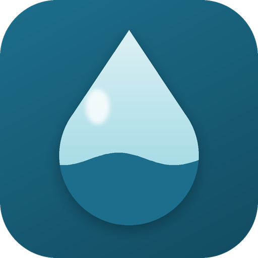

# AquaAware 2.0

[](https://github.com/omshiva24/AquaAware/actions/workflows/ci.yml)
[](https://github.com/omshiva24/AquaAware/actions/workflows/deploy-web.yml)
[](https://github.com/omshiva24/AquaAware/actions/workflows/build-apps.yml)

**Created by P Om Shiva** · M.Tech CSE (2nd year) · Pondicherry University

Water and waste awareness for **everyone**: schools, colleges, offices and communities. Members learn, act and fill their own "reservoir" of points; their group leader, NGO partners and an admin coordinate the work. The pilot runs in Pondicherry.

When a leader registers their group, they choose what kind it is, and the app's words follow:

| Kind | Leader | Members | Joins with |
|---|---|---|---|
| School | Teacher | Students | Class code |
| College | Faculty | Students | Class code |
| Office | Team lead | Employees | Team code |
| Community | Organiser | Members | Group code |

## Why I made AquaAware

> Chennai ran out of water in 2019. Bengaluru faced the same fear in 2024. More than 163 million Indians still live without safe drinking water, and the waste we throw away every day ends up in our rivers and our sea.
>
> Posters and speeches tell people about the problem, but they rarely change what anyone does the next morning. I wanted something that turns knowing into doing: learn for a few minutes, act on it the same day, and see your effort count.
>
> That is AquaAware. Every lesson finished, every bin sorted correctly, every tap closed and every litre saved fills your own reservoir, and your whole group's. It works in a school, a college, an office or a street, on any phone or computer, even without the internet.
>
> **Water does not wait for someone else to act. Neither should we.**
>
> — P Om Shiva, M.Tech CSE (2nd year), Pondicherry University

**Try it in your browser: [omshiva24.github.io/AquaAware](https://omshiva24.github.io/AquaAware/)**. Everything runs on your own device; sign in with one of the demo accounts listed below. Builds for Android, Windows, macOS and Linux are on the [Releases page](https://github.com/omshiva24/AquaAware/releases).

Version 2 is a complete rewrite of the first (React Native / Expo) version in **Flutter**, so one codebase runs on **Android, iOS, web, Windows, macOS and Linux**. It keeps every idea from version 1, makes the features that were only mock-ups real, and adds security and accessibility throughout.

- What changed from version 1, and the bugs that were fixed: [docs/WHAT_CHANGED.md](docs/WHAT_CHANGED.md)
- How the app protects people and data, in plain words: [docs/SECURITY.md](docs/SECURITY.md)
- Accessibility features and how to test them: [docs/ACCESSIBILITY.md](docs/ACCESSIBILITY.md)
- The server (optional): [server/README.md](server/README.md)

---

## Run it

You need **Flutter 3.38 or newer** (`flutter --version`). Then, in this folder:

| Your computer | Command |
|---|---|
| macOS or Linux | `./setup.sh` |
| Windows | `powershell -ExecutionPolicy Bypass -File setup.ps1` |

The setup script does three things: creates the native folders with `flutter create`, adds the permissions each feature needs (camera, location, biometrics…) with `tool/configure_platforms.dart`, and downloads packages. Then:

```bash
flutter run                 # choose a phone, emulator or desktop
flutter run -d chrome       # web
flutter test                # unit and widget tests
```

A few platform notes:

- **Windows desktop:** read-aloud needs NuGet to build: `winget install Microsoft.NuGet`.
- **Linux desktop:** secure key storage needs libsecret: `sudo apt install libsecret-1-dev libjsoncpp-dev`.
- **macOS desktop:** to keep keys in the Keychain between launches, open `macos/Runner.xcworkspace` in Xcode, pick a signing team and add the *Keychain Sharing* capability. Without it the app still runs, but keeps data in memory only (the Security Center tells you).
- **Web:** works in any modern browser. Camera scanning needs HTTPS or `localhost`.

The app works fully **offline** out of the box: all lessons, quizzes and data live on the device, encrypted.

## Demo accounts

The sign-in screen has a "Try a demo account" panel that fills these in for you. They exist only for evaluating the pilot. Build with `--dart-define=AQUA_HIDE_DEMO=true` to remove the panel.

| Role | Sign in with | Password / code |
|---|---|---|
| Student (school) | Name **Priya**, class code **AWA-2024-GHS** | Choose any 4-digit PIN the first time (not 1111 or 1234); it becomes hers |
| Student (college) | Name **Kavya**, class code **AWA-2024-CCAS** | Choose any 4-digit PIN the first time |
| Teacher (school) | kavitha@aquaaware.org | `Kavitha#2026` |
| Teacher (school) | rajan@aquaaware.org | `Rajan#2026` |
| Faculty (college) | anitha@aquaaware.org | `Anitha#2026` |
| Employee (office) | Name **Ravi**, team code **AWA-2026-CTP** | Choose any 4-digit PIN the first time |
| Team lead (office) | deepa@aquaaware.org | `Deepa#2026` |
| NGO partner | Pondicherry Science Forum | `PSF-GREEN-2026` |
| NGO partner | CEAD · Community Seva Centre · PMSSS · PSSSRF | `CEAD-GREEN-2026` · `SEVA-GREEN-2026` · `PMSSS-GREEN-2026` · `PSSSRF-GREEN-2026` |
| Admin | admin@aquaaware.org | `Manager#2026!` |

Any student on the class lists can join the same way, for example Pranil or Ashmi in AWA-2024-GHS, Vishwa or Bhanu in AWA-2024-SJH, or Arjun or Meera in the college class AWA-2024-CCAS. The demo college's name is invented. Passwords are stored only as salted hashes; change them before any real use.

## A two-minute tour on one device

1. **Student.** Join as Priya. The water in the reservoir rises to her points. Mark the NGO beach clean-up task as done (+10 points, with a small splash). During school hours non-urgent notices wait until 3 pm, so tap **Show now** if you see that note first. Open **Learn → The water crisis**, read the three slides (try the speaker button to hear them), then take the quiz.
2. **Claim a reward.** In **Rewards**, claim the *Jute bag*. You get a signed QR ticket. Tap **Copy ticket code**, then sign out from the account menu (top right).
3. **NGO partner.** Sign in as *Pondicherry Science Forum*. Open **Reward desk → Scan ticket → Enter code**, paste, and check. You'll see "Hand over: Jute bag". Paste the same code again: it is refused, because each ticket works once.
4. **Teacher.** Sign in as Mrs. Kavitha. In **Class**, open *Pranil*: the guardian's phone number stays hidden until you choose **Show**. In **Insights**, switch a chart to **Show as table**.
5. **Admin.** Sign in as the admin. The **audit log** on the overview shows the phone number you revealed and the reward you handed over. Open **Privacy and security** to run the live checks.

6. **College and office.** Sign in as the college student *Kavya* (class AWA-2024-CCAS): the home screen says *Message faculty*. Then join as *Ravi* with team code AWA-2026-CTP: he is an *employee* whose *team lead* is Ms. Deepa, and office notices are never held back. To create your own group, choose **Teacher or team lead → Register it here** and pick **School**, **College**, **Office** or **Community**.
7. **Who made it.** Tap **Why I made AquaAware** under the sign-in form, or **About AquaAware** in the account menu.

Also try **Settings and accessibility** (account menu): dark theme, high contrast, larger text, reduce motion, and a longer or switched-off quiz timer.

## Connect devices with the server (optional)

Offline, each device keeps its own data. To share announcements and completions between phones (an educator posts, the class sees it within about 20 seconds), and to record points, quiz scores and redemptions centrally, run the server:

```bash
cd server
npm start              # Node.js 22.13+; there are no packages to install
```

Then start the app pointed at it:

```bash
flutter run --dart-define=AQUA_API_URL=http://127.0.0.1:8443   # desktop or iOS simulator
flutter run --dart-define=AQUA_API_URL=http://10.0.2.2:8443    # Android emulator
```

Debug builds allow plain `http://` only for a server on the same computer. A real deployment must use an `https://` address. Signing in on the device then also signs in to the server with the same details. Updates are signed, retried and never counted twice. See [server/README.md](server/README.md).

## What each role can do

**Students, employees and members:** the reservoir and streak; tasks from their leader and NGOs (at schools and colleges, non-urgent ones wait until after class); six illustrated lessons with read-aloud; quizzes with an adjustable timer; the drag-and-drop sorting challenge, which can also be played by tapping; the eco-map with the three nearest free collectors and pickup tracking; rewards as signed QR tickets; NGO event check-ins; badges and a points history.

**Teachers, faculty, team leads and organisers:** a group overview with who needs support; announcements with completion tracking; private messages with students; a roster with masked phone numbers and PIN reset; file sharing with safety checks; charts that can be read as tables.

**NGO partners:** broadcasts to every school and college, or to one class; event scheduling with a check-in QR code that changes every 15 minutes; a reward desk that verifies tickets; the partner map.

**Admin:** programme progress; alerts (ledger integrity, tampered data, lockouts, refused updates, students at risk); a searchable directory; moving a student to another class without losing points; the audit log; demo-data reset.

## The course concepts (Q1–Q12) in the code

| | Concept | Where it lives |
|---|---|---|
| Q1 | Adaptive quality on slow networks | `core/platform/device_context.dart`, `AdaptiveImage` in `widgets/common.dart`, *Data saver* setting |
| Q2 | Battery awareness, push relay, quiet hours | `DeviceContext.shouldConserveEnergy` pauses motion on low battery; quizzes save after every answer; class-hours hold in `student_screens.dart`; server fan-out in `server/src/realtime.js` |
| Q3 | Points and badges follow a student | Points ledger keyed by student (`core/security/ledger.dart`); admin *Move to another class* |
| Q4 | Smart paging, daily tip broadcast | `AppStore.nearestFree` alerts only the 3 nearest free collectors; `ContentSeed.tipFor` |
| Q5 | Reliable delivery (ARQ) | `core/net/sync_service.dart`: encrypted outbox, 3 attempts, back-off, idempotency keys |
| Q6 | Data partitioned by class | Class codes scope every query; the server checks who may see each announcement |
| Q7 | CIA triad; 4W context | AES-256-GCM storage, HMAC ledger, signed updates; the student greeting (who, when, where, what next) |
| Q8 | Reward claim checks; lightweight JWT | Geofence with real distances, simulated-GPS rejection, 3 claims a day; HS256 JWT on the server |
| Q9 | QR anti-replay; SMS fallback | `core/security/signed_token.dart` + used-nonce ledger; SMS button for collectors when offline |
| Q10 | Low-end devices | Small Android screens get lighter images |
| Q11 | TLS instead of IPSec | HTTPS-only sync (TLS 1.2+); the server refuses to run without TLS in production |
| Q12 | Biometrics; IoT water meter | Staff quick unlock (`local_auth`); the school or college tank reading and daily bonus (`WaterMeter`) |

## Project layout

```
lib/
  core/        theme tokens, security (crypto, vault, ledger, tokens, input and file rules),
               platform services (location, biometrics, speech, device context), sync
  data/        models, the encrypted store, points rules, seed content
  services/    start-up, authentication, settings
  routing/     role-based routes and the four navigation shells
  widgets/     reservoir, charts, eco-map, slide illustrations, shared components
  features/    auth, student, educator, ngo, manager, shared screens
test/          security, logic, sync (fake server) and whole-app smoke tests
tool/          configure_platforms.dart (permissions, app name, icons, web loading screen)
branding/      app icon at every size the web and Android need
server/        zero-dependency Node.js API with its own tests (npm test)
docs/          what changed, security, accessibility
.github/       automatic checks, web deployment and app builds
```

## Automatic builds and deployment

Three GitHub Actions workflows run on every push to `main`:

| Workflow | What it does |
|---|---|
| **Checks** (`ci.yml`) | `flutter analyze`, every Flutter test, and the server's tests |
| **Deploy web app** (`deploy-web.yml`) | Builds the web version and publishes it on GitHub Pages |
| **Build apps** (`build-apps.yml`) | Builds Android (APK), Windows, macOS and Linux, and compiles iOS as a check. The builds can be downloaded from the workflow run |

To publish a release with downloadable apps, open **Releases → Draft a new release** on GitHub, type a new tag such as `v2.0.1`, and choose **Publish release**. About 15 minutes later the Android, Windows, macOS and Linux builds are attached to it automatically. Pushing a tag from the command line does the same:

```bash
git tag v2.0.1
git push origin v2.0.1
```

These are test builds: the Android APK uses a debug signing key, and the macOS app is not notarised (right-click it and choose **Open** the first time). Publishing to the Play Store or App Store needs your own signing keys.

## Author and copyright

AquaAware was designed and built by **P Om Shiva**, M.Tech Computer Science and Engineering (2nd year), Pondicherry University ([github.com/omshiva24](https://github.com/omshiva24)).

**Copyright © 2026 P Om Shiva. All rights reserved.** The code is published so it can be read and evaluated. It may not be copied, changed, republished or reused in another project, in whole or in part, without the author's written permission. See [LICENSE](LICENSE).

## Credits

Typeface: Atkinson Hyperlegible Next by the Braille Institute (SIL Open Font License, `assets/fonts/OFL.txt`). Maps © OpenStreetMap contributors. Sample gallery photos from picsum.photos stand in for NGOs' own photos.
